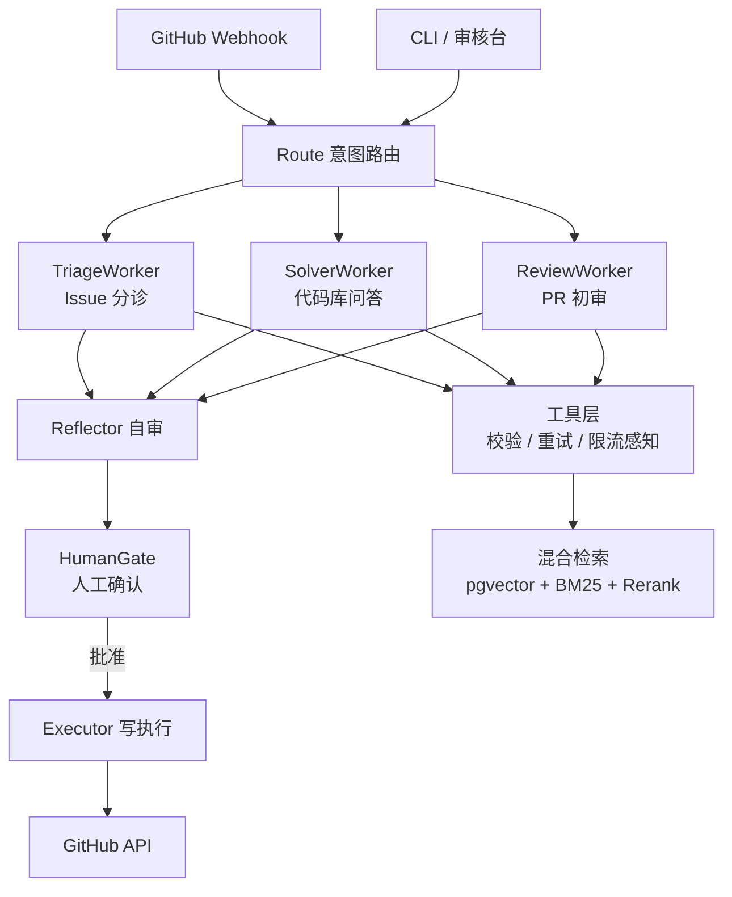

# Maintainer Copilot

面向开源项目维护者的 AI 协作者：**Issue 自动分诊**、**代码库问答**、**PR 初审**，所有对外输出（评论/标签）经人工确认后发布。

> 一句话：把你的 issue 从「积压清单」变成「已分诊的待审草稿」。

**Agent 定位：workflow-first Agent** —— 控制流由显式状态机 + 确定性闸门决定：路由用规则、自审用可枚举判定、写操作只经确定性 Executor 执行；LLM 只承担节点内的语言任务，不掌握流程决策与写权限。

## 为什么需要它

中小开源项目（1-3 人维护）的 issue 大量是重复问题、环境配置问题和无效 issue；维护者重复回答文档里写过的内容；新人 PR 缺乏初审。Maintainer Copilot 在维护者与 issue 队列之间加了一层可审计的 AI 助理：

- **安全第一**：写工具（评论/标签）不进 LLM 的工具列表，只由确定性 Executor 在人工批准后执行；
- **代码库感知**：检索基于代码（tree-sitter AST 切分）+ 文档 + 历史 issue 三源异构索引，不是普通文档问答；
- **效果可度量**：内置评测体系（分诊 F1 / 引用精确率 / LLM-as-judge），用真实历史 issue 作回归集。

## 架构



## Quick Start

```bash
# 1. 环境准备（Python >= 3.13; 数据库用 docker compose 一键起 pgvector）
pip install uv
docker compose up -d

# 2. 安装依赖
uv sync                  # 核心依赖
uv sync --extra rag      # RAG 重依赖（embedding / rerank / tree-sitter）

# 3. 配置
cp .env.example .env     # 填入 MC_DEEPSEEK_API_KEY

# 4. 跑起来
uv run mc chat           # CLI 问答（POC）
uv run mc serve          # Web 审核台 http://127.0.0.1:8000
uv run mc mcp            # MCP stdio 模式
uv run pytest            # 测试
```

## 演示

```bash
uv run mc ask --repo freeisle/12306 "候补购票是怎么实现的？"   # 代码库问答(带引用)
uv run mc demo-triage freeisle/ragent 108                        # Issue 分诊
uv run mc demo-hitl freeisle/ragent 67                           # HITL 全链路(自审->人工批准->执行)
uv run mc mcp                                                    # MCP stdio 模式
uv run python -m eval.run_eval --suite triage --repo eval/dubbo  # 分诊 F1 评测
```

完整演示流程见 [docs/demo-walkthrough.md](docs/demo-walkthrough.md)。

## 评测基线

| 套件 | 指标 | 基线 | 说明 |
|---|---|---|---|
| 分诊 | macro-F1 | **0.49**（bug 0.79 / feature 0.50 / question 0.68 / invalid 0.00） | dubbo+rocketmq 真实标签 77 条 4 类回归集；invalid 类为 duplicate/wontfix 标注口径所致，详见报告分析 |
| 问答 | LLM-as-judge 三维 rubric | correctness 3.6 / citation_support 3.6 / usefulness 2.7（5 分制） | 10 问 + 引用硬指标; 收紧引用约束后较初版 2.7/2.2/3.0 显著提升 |
| 检索 | Hit@3 / Recall@5 / MRR | **0.75 / 0.5208 / 0.5417** | n=8（ragent 6 + 12306 2）单次运行，LLM 改写 temperature=0；主要瓶颈在召回层，详见 [retrieval-baseline](eval/reports/retrieval-baseline.md) |

报告生成于 `docs/eval-report/`，可通过 `python -m eval.run_eval` 复现。

2026-10-25 新增 [真实 PostgreSQL / pgvector v2 回归](eval/reports/retrieval-pgvector-v2.md)：n=24、3 仓库，Hit@3 **0.7917** / Recall@5 **0.7569** / MRR@8 **0.6806**。保留 3 条 top-8 未命中；与上表历史 n=8 不直接比较。环境、隔离测试和恢复演练见 [实库验证说明](docs/postgres-validation.md)。

### 分诊迭代记录（如实）

判别规则增强后基线 0.4886 → **0.4922**（77 样本 4 类），目标（macro≥0.55 / feature≥0.70）未达成。27 例错误三层根因（详见 triage 报告分析）：

1. 判别规则反作用：how-to 求助被"疑问句+请求行为改变"规则推向 feature（6 例）；
2. invalid 标注口径冲突：duplicate/wontfix 样本的内容本就是 bug/feature 的重复提交；
3. 带错误日志的 enhancement 仍是硬案例。

下一轮方向：① how-to 求助明确归 question；② invalid 类改用真实"信息不足"样本或调整口径；③ question 类补索引集 few-shot。

## 技术栈

| 层 | 组件 |
|---|---|
| Agent 编排 | LangGraph（workflow-first 状态机 / 动态 HITL interrupt / SQLite WAL 持久化 checkpoint） |
| RAG | pgvector + BM25 + RRF 融合 + BGE-reranker；tree-sitter AST 切分；BGE-M3 embedding |
| 工具层 | 自研 GitHub 客户端（限流感知 / 5xx 退避重试 / 内存缓存，13 个公开方法）+ FastMCP 暴露 3 个读工具 |
| 服务 | FastAPI（webhook + HITL 审核台） |
| 评测 | 分诊 F1 回归集 + LLM-as-judge（三维 rubric）+ 引用精确率硬指标 |
| LLM | DeepSeek（主）/ Ollama（兜底），OpenAI 兼容协议 |

## 里程碑

| Milestone | 内容 | 状态 |
|---|---|---|
| M1 | 代码库问答 MVP（三源索引 + 混合检索 + 带引用回答） | ✅ |
| M2 | 分诊 + HITL 闭环（webhook → 草稿 → 审核台 → 发布）+ 评测体系 | ✅ |
| M2.5 | 引用约束收紧、PR 初审、长期版本化偏好、工具选择评测、Skill 加载、增量更新、CI、采纳率采集 | ✅ |
| Roadmap 扩展 | 持久化/记忆/限流快照/评测扩充/联邦检索/A2A/Java MCP | ✅（详见验收记录） |
| 待外部验证 | 原库历史索引清理、Skill 语义回归、Langfuse 部署、业务后训练 | 🔲 |

## 当前边界（如实记录）

工程上尚未完成、或与常见预期不同的部分，主动列出以免误读：

| 项 | 现状 |
|---|---|
| checkpoint | 默认单机 SQLite WAL/FULL，跨进程 HITL 恢复已验证；不承诺分布式高可用或 GitHub exactly-once，见 [持久化说明](docs/persistence.md) |
| 编排粒度 | Supervisor + 3 Worker 均为 `add_node` 注册的普通节点函数；未使用 LangGraph 已编译子图 |
| 工具层 | 已注册 3 个读工具（底层客户端 13 个公开方法：11 读 + 2 写）；Registry 的校验 / 超时 / 结构化错误对外经 MCP 暴露，图内 Worker 直接调用检索与 GitHub 客户端 |
| 限流 | 429/明确限流 403 接入本地快照证据降级；鉴权失败/超时不触发此降级；GitHub 外层不重复重试 |
| 检索指标 | baseline 已跑出：Hit@3=0.75 / Recall@5=0.5208 / MRR=0.5417（n=8，单次运行）；原 baseline 保留；另有 n=24/3 仓库 v2 离线词法、真实 pgvector 混合及 rerank 消融；原库保持不变，不能与 n=8 直接比较 |
| 判官 | 单判官 + `temperature=0`，与生成侧同源；交叉校验依赖程序硬指标（引用精确率）。双判官 / 位置交换在 roadmap |
| 短期记忆 | 已接入 LangGraph 入口、Solver 上下文和 CLI；同一 checkpoint 保存有界历史，线程隔离及任务锚点测试通过 |

## 扩展功能与验收

- [实施顺序、测试与阶段提交](docs/roadmap-execution.md) / [当前 Roadmap](docs/roadmap.md)
- [联邦检索、A2A 与 Java MCP](docs/services.md)
- [Skill 候选、人工审核和回滚](docs/skill-evolution.md)
- [本地 trace 与 Langfuse 部署准备](docs/observability.md)
- [后训练数据门槛和离线训练流程](docs/posttraining.md)

```powershell
# 无 PostgreSQL 的独立词法评测；首次 --build 构建快照
uv run python -m eval.offline_retrieval --build
# 后续复评相同快照，保留报告与源文件 hash
uv run python -m eval.offline_retrieval
mvn -B -f services/java-tools/pom.xml test package
uv run pytest -q
```

## License

[Apache-2.0](./LICENSE)
