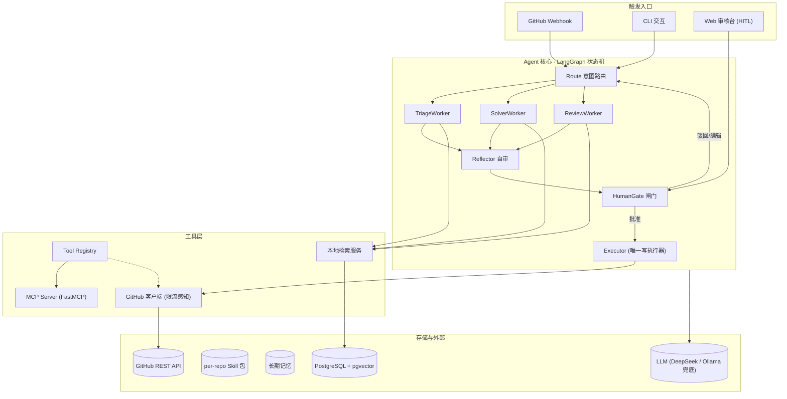
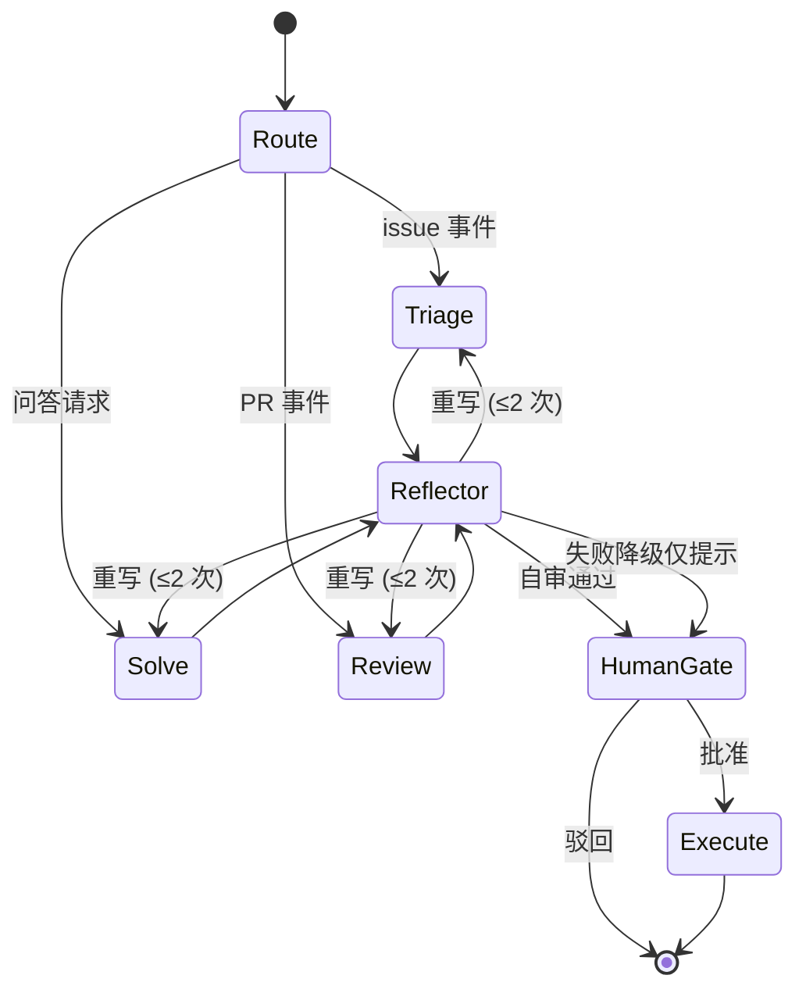

# Architecture（公开版）

> 详细设计决策见 `docs/architecture.md` 各节；个人开发记录存放于本地 devlog（不入库）。

## 1. 总体架构

> 节点说明：`Route / Triage / Solve / Review / Reflector / gate / degrade / executor` 为图中 **8 个真实节点**（均以 `add_node` 注册的普通函数）。
> `REG`（Tool Registry）**不在图执行链路上**（图中以虚线表示）：Worker 直接调用检索与 GitHub 客户端，Registry 的校验 / 超时 / 结构化错误对外经 `MCP` 暴露。Executor 在批准后直接调用 `GitHubClient` 完成写操作。

## 2. 状态机

> 节点内流水线（**不是图节点**）：`Solve` 内部依次执行 QueryRewrite → Retrieve（混合检索 + Rerank）→ 带引用回答 → 引用校验；`Triage` / `Review` 同理为单节点内的多步处理。图中未展开为子图，因为当前没有已编译子图参与编排。

## 3. 关键设计决策与理由

| 决策 | 选择 | 理由 |
|---|---|---|
| 单 Agent vs Multi-Agent | Supervisor + 3 Worker 节点 | 上下文隔离、职责单一可独立评测、状态机显式可控；单 Agent + 多工具在工具数增长后选择准确率下降且评测困难 |
| A2A vs 单进程节点通信 | 类型化共享状态 | 单机部署无跨服务边界；A2A 留给工具服务化阶段（roadmap） |
| 框架 | LangGraph | 状态机显式控制 + 动态 HITL interrupt 成熟；编排定位 **workflow-first Agent**，流程决策不交给 LLM |
| 向量库 | pgvector | 规模不需要分布式 Milvus；SQL 管理索引、单 docker 服务 |
| 混合检索 | 三通道：pgvector 向量 + 进程内 BM25 + 报错串精确检索；自实现 RRF 融合 + BGE-reranker 重排 | RRF 融合可解释可控，避免 Qdrant/ES 黑盒与额外服务 |
| GitHub 接入 | 自研 httpx 客户端（13 个公开方法） | 限流/重试/缓存细节可控；不引第三方 SDK |
| MCP | FastMCP 暴露同一工具层（双接口） | 内部直调 + 外部协议互不干扰 |
| 写安全 | 写工具不进 LLM 工具列表，仅 Executor 执行 | 结构性杜绝 LLM 直接触碰写权限 |

### 3.1 当前边界（如实）

- **checkpoint**：`build_graph()` 默认分支尝试 `SqliteSaver`，但 `langgraph-checkpoint-sqlite` 未列入依赖，异常回退 → 运行时实际为**进程内 `InMemorySaver`**。动态 HITL interrupt + resume 可用；**跨进程恢复待持久化补全（后续计划）**。
- **编排粒度**：8 个节点均为 `add_node` 注册的普通函数，**无已编译子图**参与编排。
- **工具层**：已注册 3 个读工具（底层客户端 13 个公开方法：11 读 + 2 写）。Registry 的校验 / 超时 / 结构化错误对外经 MCP 暴露；**图内 Worker 不经过 Registry**，直接调用检索与 GitHub 客户端。
- **限流降级**：429 抛出 `RateLimitExceeded` 快速失败不重试；5xx / 网络错误已实现指数退避（最多 4 次尝试）。**「429 降级到本地索引」为后续计划（未实现）**。
- **检索评测**：当前 retrieval baseline——dataset n=8，Hit@3=0.75，Recall@5=0.5208，MRR=0.5417（单次运行；LLM query rewrite temperature=0；主要瓶颈来自召回层——Recall@3=@5=@8 持平，提高 k 无收益；详见 `eval/reports/retrieval-baseline.md`）。
- **短期记忆**：`memory/short_term.py` 的滑动窗口 + 滚动摘要 + 任务锚点已实现并带单测，**尚未接入主链路（后续计划）**。

## 4. 核心难点与解法

1. **代码库检索答非所问**：三源异构索引（代码 AST 切分 / 文档标题切分 / issue 结构化切分）+ 混合检索 + 领域化查询改写（报错串精确检索优先）+ rerank + 引用精确率硬指标。
2. **幻觉对外发布**：引用强制 → Reflector 三查（有出处 / 答所问 / 符合规范）→ 重写 ≤2 次 → 失败降级仅提示 → HITL 闸门 → 灰度策略。
3. **GitHub 限流与外部依赖不可靠**：检索本地化 + 限流感知客户端（429 快速失败不重试、5xx/网络错误指数退避，最多 4 次尝试）+ webhook 幂等去重 + LLM 主备双通道。

## 5. 评测体系

- **分诊集**：真实历史 issue 的 label 作弱标注，macro-F1 按类度量（实测 77 样本 4 分类，见 docs/eval-report/）；
- **问答集**：被维护者关闭的历史 issue，LLM-as-judge 三维 rubric（正确性/引用支撑/可用性）+ 引用精确率程序硬指标；
- **工具选择集**：查询 → 期望工具，验证 tool description 质量；
- **检索集**：查询 → 期望文档（n=8，ragent 6 + 12306 2），指标为 hit@k / MRR / Recall；baseline 已跑出：Hit@3=0.75 / Recall@5=0.5208 / MRR=0.5417（单次运行），详见 `eval/reports/retrieval-baseline.md`；
- **判官偏差缓解**：temperature=0（已实现）；判官与生成侧**同源**（同一 Provider），故以程序硬指标（引用精确率）作交叉校验；双判官、位置交换在 roadmap（未实现，不宣称）。

## 6. 演进路线

见 [roadmap.md](roadmap.md)。
